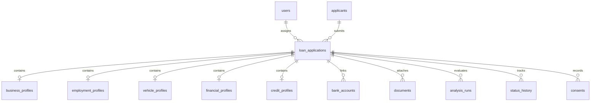

# Scadova-AI-India Database Architecture

## Overview
The database layer uses SQLAlchemy 2.0 with PostgreSQL in production (and SQLite support for local rapid test isolation). Schema versioning is managed via Alembic.

---

## Entity Relationship Summary

---

## Table Schema Details

### 1. `users`
- `id` (UUID string, PK)
- `tenant_id` (Indexed)
- `email` (Indexed, Unique)
- `hashed_password` (Bcrypt string)
- `full_name`
- `role` (ADMIN, MANAGER, ANALYST, AGENT, APPLICANT)
- `is_active` (Boolean)
- `created_at`, `updated_at` (UTC DateTime)

### 2. `applicants`
- `id` (UUID string, PK)
- `tenant_id` (Indexed)
- `user_id` (FK to `users.id`)
- `first_name`, `last_name`
- `email`, `phone` (Indexed)
- `pan_masked`, `aadhaar_masked`
- `date_of_birth`, `gender`
- `current_address`, `city`, `state`, `pincode`
- `created_at`, `updated_at`

### 3. `loan_applications`
- `id` (UUID string, PK)
- `tenant_id` (Indexed)
- `applicant_id` (FK to `applicants.id`, Indexed)
- `application_number` (Unique, Indexed)
- `loan_type` (`BUSINESS_LOAN`, `PERSONAL_LOAN`, `USED_CAR_LOAN`)
- `status` (`DRAFT`, `DATA_PENDING`, `DOCUMENTS_PENDING`, `READY_FOR_ANALYSIS`, `ANALYSIS_COMPLETE`, etc.)
- `requested_amount` (Numeric 14,2)
- `preferred_tenure_months` (Integer)
- `loan_purpose` (Text)
- `assigned_agent_id` (FK to `users.id`)
- `created_at`, `updated_at`

### 4. `business_profiles`
- `id` (UUID string, PK)
- `application_id` (FK to `loan_applications.id`, Unique)
- `business_name`, `entity_type`, `business_starting_year`
- `gst_status`, `gstin_masked`, `udyam_msme_status`
- `previous_year_turnover`, `current_fy_turnover`
- `average_monthly_bank_credits`, `net_profit_annual`
- `existing_business_loans_count`, `current_outstanding`, `existing_monthly_emi`
- `liability_takeover_requirement` (Boolean)

### 5. `employment_profiles`
- `id` (UUID string, PK)
- `application_id` (FK to `loan_applications.id`, Unique)
- `employment_type`, `company_name`, `designation`
- `total_work_experience_years`, `industry_category`
- `gross_salary_monthly`, `net_salary_monthly`
- `annual_income`, `existing_monthly_emi`
- `balance_transfer_requirement` (Boolean)

### 6. `vehicle_profiles`
- `id` (UUID string, PK)
- `application_id` (FK to `loan_applications.id`, Unique)
- `vehicle_make`, `model`, `variant`
- `manufacturing_year`, `registration_year`
- `registration_number_masked`, `fuel_type`, `transmission`
- `market_value`, `valuation_amount`, `purchase_price`, `down_payment`
- `rc_status`, `accident_history`, `refinance_or_bt_requirement`

### 7. `documents`
- `id` (UUID string, PK)
- `application_id` (FK to `loan_applications.id`, Indexed)
- `document_type`, `file_name`, `storage_path`, `mime_type`, `file_size_bytes`
- `verification_status` (`PENDING`, `VERIFIED`, `REJECTED`)
- `uploaded_at`

### 8. `analysis_runs`
- `id` (UUID string, PK)
- `application_id` (FK to `loan_applications.id`, Indexed)
- `run_number` (Integer)
- `rule_outcome` (`PASS`, `REFER`, `DECLINE`, `DATA_REQUIRED`)
- `eligible_amount`, `calculated_emi`, `foir_before`, `foir_after`, `ltv_percentage`
- `rule_reason_codes`, `missing_information`, `strengths`, `risk_factors` (JSON)
- `recommended_lender_category` (`PRIME_BANK`, `NBFC_OR_FINTECH`)
- `ai_summary`, `disclaimer`
- `created_at`

### 9. `status_history`
- `id` (UUID string, PK)
- `application_id` (FK to `loan_applications.id`, Indexed)
- `from_status`, `to_status`
- `changed_by_user_id`, `remarks`, `timestamp`

### 10. `audit_events`
- `id` (UUID string, PK)
- `tenant_id` (Indexed)
- `event_type` (Indexed)
- `entity_type`, `entity_id`
- `user_id`, `ip_address`, `details` (JSON)
- `created_at` (Indexed)
